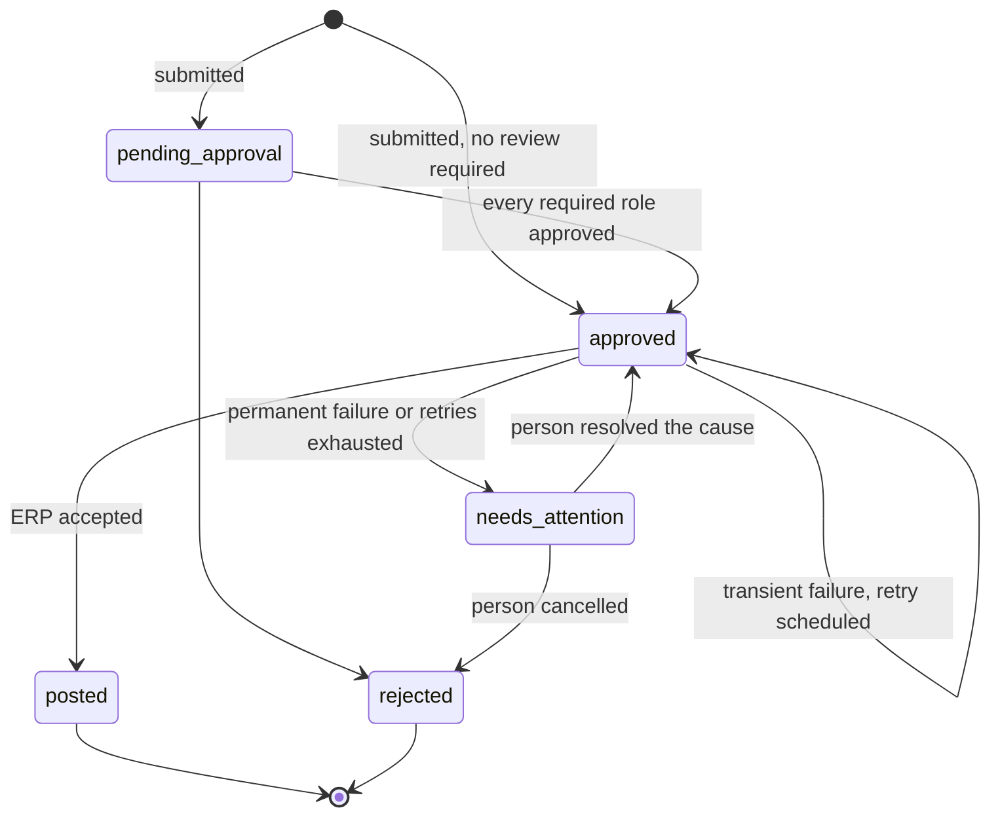

# Synthetic operations demo

> **Synthetic demonstration.** The company, people, vendors and amounts in this repository are invented. Nothing here describes a customer, a customer outcome or production performance.

Business software is rarely hard because of its screens. It is hard because of what happens around them: approvals that depend on who is asking and how much, systems of record that fail in ambiguous ways, exceptions that no retry can fix, and rules that change while work is already in flight.

This repository walks one small operation through that whole cycle: purchase approvals feeding an ERP. The code is written to be read. Every behavior shown in the demo is covered by tests.

```
pnpm install
pnpm demo          # the operation, end to end
pnpm demo:impact   # a business-rule change, replayed before it ships
pnpm verify        # lint, typecheck, 43 tests
```

Requires Node.js 22.18 or later (TypeScript runs natively, with no build step) and pnpm. There are no runtime dependencies.

## The operation

A mid-sized distributor buys materials, equipment and services. Every purchase request must be approved according to spend policy and then posted to the ERP as a purchase order. The policy is the part of the business that changes; the ERP is the part that fails.



## What the demo shows

| Stage | What happens in the demo | Where it lives |
|---|---|---|
| **Build** | Policy decides which roles must approve, and why. The requester cannot approve their own request; one person cannot satisfy two approvals. | [`src/rules/policy.ts`](src/rules/policy.ts), [`src/domain/purchase-request.ts`](src/domain/purchase-request.ts) |
| **Operate** | The ERP returns 503 twice, then succeeds. Another call times out *after* the ERP committed the order; the retry is recognized by its idempotency key and no duplicate is created. | [`src/application/purchase-request-service.ts`](src/application/purchase-request-service.ts), [`src/infrastructure/synthetic-erp.ts`](src/infrastructure/synthetic-erp.ts) |
| **Observe** | A request fails because the vendor does not exist in the ERP. Retrying cannot fix that, so it goes to a person, who resolves it. Every step is in an append-only audit trail, and the value signals are derived only from those events. | [`src/observability/`](src/observability) |
| **Evolve** | Policy 1.1 adds two rules. Requests submitted before the change keep the policy they started under. Before shipping, last month's requests are replayed under both versions to show exactly what would change. | [`src/rules/versions.ts`](src/rules/versions.ts), [`src/rules/impact.ts`](src/rules/impact.ts) |

## Design decisions

- **Rules are versioned data, stamped at submission.** A request is decided by the policy in effect when it was submitted, never by whatever is current when someone gets to it. See [ADR 0001](docs/adr/0001-versioned-rules-stamped-at-submission.md).
- **Failures are classified before they are handled.** Transient failures are retried with capped backoff. Permanent failures go straight to a person. Unknown failures are treated as transient, which is only safe because every attempt carries the same idempotency key. See [ADR 0002](docs/adr/0002-idempotent-posting-and-failure-classification.md).
- **Separation of duties is an invariant, not a rule.** No policy version is able to relax it, so it lives in the domain rather than in the policy.
- **Money is integer cents.** No floating-point arithmetic touches an amount.
- **Storage and the ERP sit behind ports.** The in-memory adapters keep the demo runnable in seconds; a relational adapter would replace them without touching the domain. See [ADR 0003](docs/adr/0003-ports-in-memory-adapters-no-runtime-dependencies.md).

## Patterns implemented

This repository is a working companion to [business-software-patterns](https://github.com/Blaxline/business-software-patterns). It implements, in running code: explicit process state, state transitions, workflow versioning, decision tables, approval thresholds, multi-stage approvals, separation of duties, exception handling, idempotent operations, retries and backoff, external dependency failure, audit trails, business events and value signals.

## What this is not

- **Not a product or a framework.** It is a demonstration of reasoning, sized to be read in one sitting.
- **Not production infrastructure.** Storage is in memory, there is no authentication, and the posting job runs on demand rather than on a scheduler. The boundaries where those would plug in are explicit.
- **Not a claim about any real system.** The ERP is a deterministic stand-in with scripted failure modes.

## Project layout

```
src/
  domain/          purchase request, state machine, separation of duties, money
  rules/           policy model, versions 1.0 and 1.1, impact replay
  application/     use cases and the ports they depend on
  infrastructure/  in-memory store, synthetic ERP, controlled clock
  observability/   business events and derived value signals
  demo/            the two runnable demonstrations
test/              behavior and edge cases, one file per concern
docs/adr/          architecture decision records
```

## License

[MIT](LICENSE). Copyright 2026 Blaxline Group, LLC.

---

Maintained by [Blaxline](https://blaxline.com), which designs, builds, operates and evolves custom business software for important operations that standard tools no longer fit.
